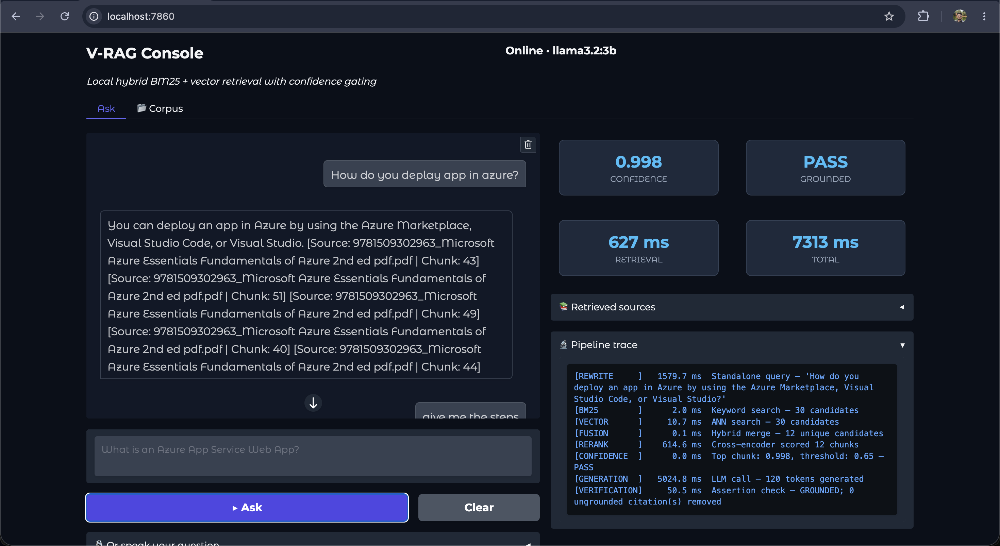
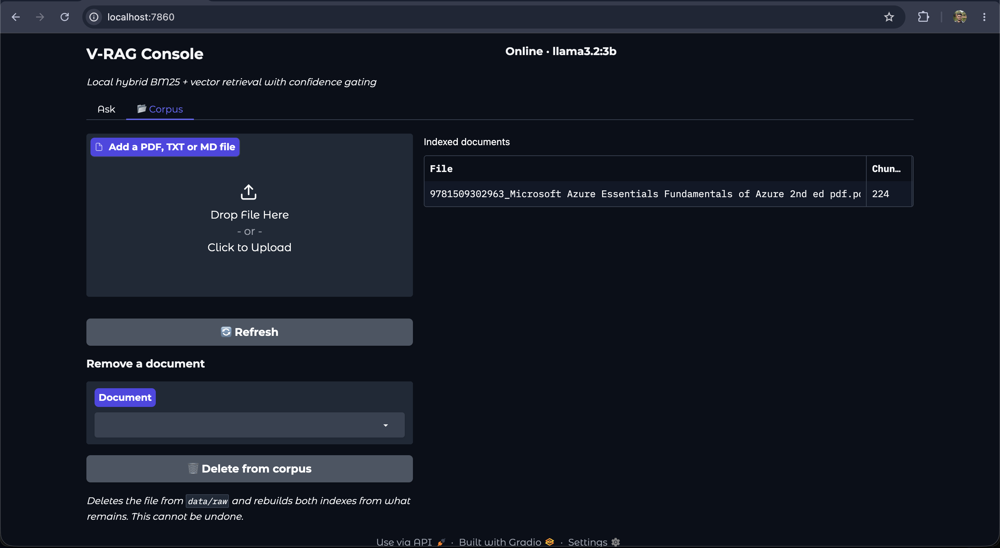
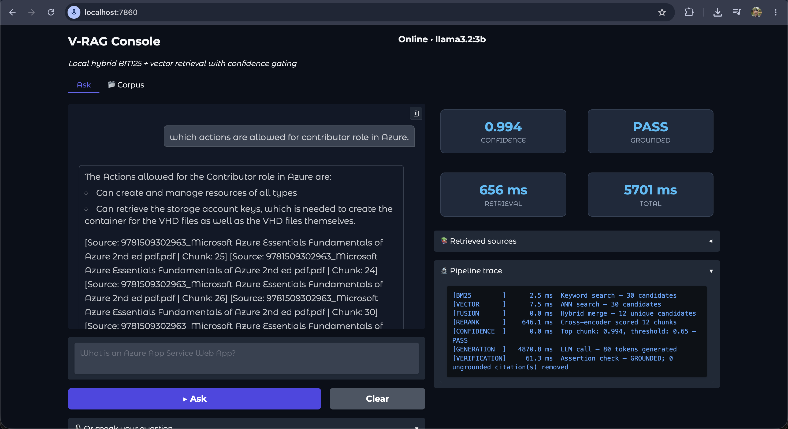
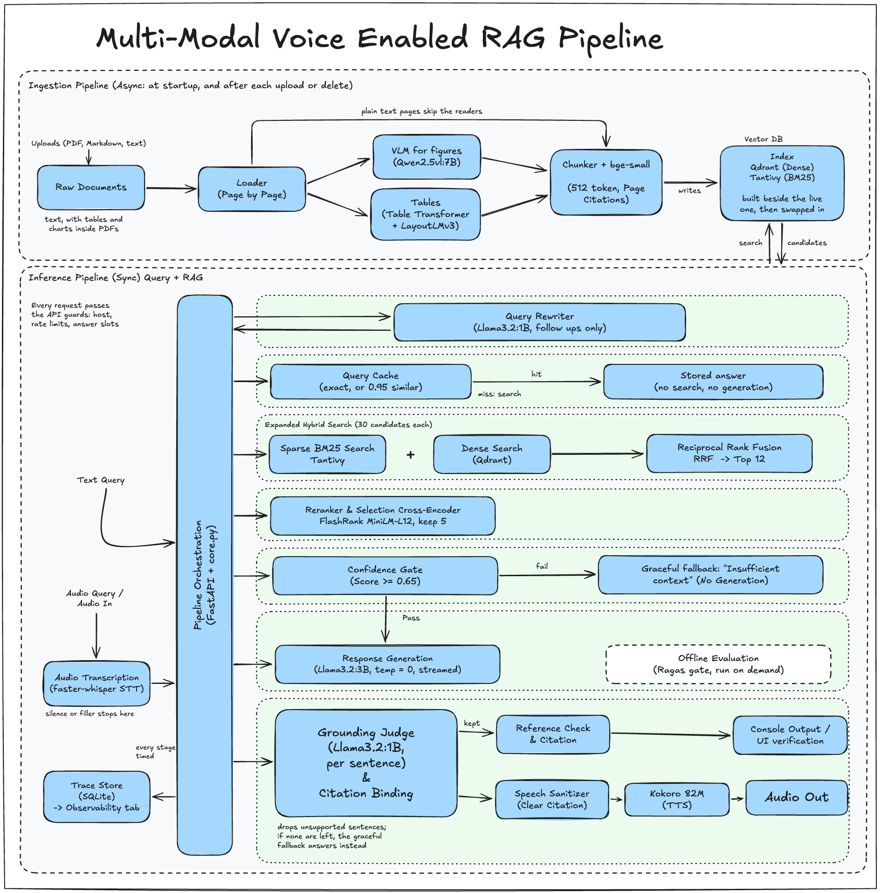

# V-RAG: Voice Enabled RAG Pipeline

A question answering system for your own documents that refuses rather than guesses. Ask by typing
or by speaking, and get an answer drawn only from the documents you supplied, with the file and page
it came from.

Everything runs on your machine. No cloud APIs, no vendor keys, no data leaving the laptop.

---

## The S-Y-N-C-H-R-O-N-I-C Framework

| Step | Principle | Definition |
| :--- | :--- | :--- |
| **S** | Standardize Ingestion | Clean, normalize Unicode, strip artifacts, and hash all incoming documents to ensure identical processing. |
| **Y** | Yield Hybrid Results | Combine dense vector embeddings with sparse keyword matching (BM25) to capture both semantic meaning and exact phrases or clause numbers. |
| **N** | Narrow with ANN | Use Approximate Nearest Neighbor algorithms (HNSW, ScaNN) to rapidly down-select millions of vectors into a manageable candidate pool in milliseconds. |
| **C** | Cross-Encode (Rerank) | Pass the candidate pool through a heavy cross-encoder that scores queries and chunks jointly, sorting the best context to the top. |
| **H** | Halt on Low Confidence | Calculate a source confidence score from retrieval math, freshness and authority. Gate the pipeline so it halts and refuses to answer when the context isn't trustworthy. |
| **R** | Restrict the LLM | Use hard, explicit system prompt constraints and temperature 0.0 to strip out creativity and enforce strict compliance. |
| **O** | Origin Citations | Mandate that every claim in the generated output maps back to an explicit source document, page number and paragraph offset. |
| **N** | NER & Assertion Checking | Run automated post-processing using Named Entity Recognition to pull factual claims from the response and verify they are grounded in the source text. |
| **I** | Inspect Continuously | Monitor quality metrics continuously — context relevance, faithfulness and answer relevance — to catch performance drift immediately. |
| **C** | Cache & Invalidate | Implement an exact and semantic two-level caching layer to save latency and cost, invalidating entries the second a source document changes. |

These are the article's principles. Here is how far V-RAG implements each one today:

| Step | In V-RAG |
| :--- | :--- |
| **S** | Done: Unicode normalization, cleanup, and a SHA256 content fingerprint per document, so the same file gets the same chunk ids on every run. |
| **Y** | Done: Tantivy keyword search (BM25) and Qdrant meaning search, merged with reciprocal rank fusion. |
| **N** | Not yet: Qdrant runs in embedded local mode, which compares the query with every stored vector (exact search, no ANN index). Fine at a few hundred chunks; not tested at millions. |
| **C** | Done: FlashRank cross encoder (`ms-marco-MiniLM-L-12-v2`) reorders the candidates. |
| **H** | Partly: the gate uses the reranker score only (refuses below 0.65). No freshness or authority scoring. |
| **R** | Done: a strict system prompt and temperature 0.0. |
| **O** | Partly: every answer cites file and page (PDFs) or chunk (text files). No paragraph offsets. |
| **N** | Partly: spaCy NER flags names and codes that are not in the retrieved text, and citations to passages that were not retrieved are removed. A failed check is reported, not acted on yet. |
| **I** | Partly: a manual Ragas quality gate and a latency benchmark, run on demand. No continuous monitoring. |
| **C** | Done: exact and similar question caches, cleared whenever a document changes. |

## Credits

This project is built on the S-Y-N-C-H-R-O-N-I-C framework described by **Vishal Mysore** in
[How to Design a RAG Pipeline for 10 Million Documents with Zero Hallucination](https://medium.com/@visrow/how-to-design-a-rag-pipeline-for-10-million-documents-with-zero-hallucination-live-demo-057e37bcdbf6).
The framework supplied the ten design principles above; this repository is an independent
implementation of them on a fully local stack.

---
## Project Screen Shots

- Main console
  

- Corpus tab
  

- English spoken question and answer
  

  [Sample audio output](assets/audio_outputs/english_sample_output.wav)

The screenshots and the audio sample were recorded before page citations and before spoken answers
were cleaned of formatting, so they show chunk citations and the sample reads a list marker aloud.
---
## Repository Layout

```
Voice_Enabled_RAG_Pipeline/
├── .github/
│   └── workflows/
│       └── rag_eval_ci.yml          # CI: fast tests on every PR, Ragas gate on demand
├── assets/                          # Screenshots, the architecture diagram, an audio sample
├── config/
│   └── config.yaml                  # Every tunable setting: models, thresholds, paths, cache
├── data/
│   ├── raw/                         # Your source documents (PDF, TXT, MD)
│   └── eval/
│       └── golden_dataset.json      # 67 evaluation questions (47 in-scope + 20 adversarial)
├── docs/
│   └── ragas_gate_run.txt           # Recorded output of a passing quality-gate run
├── src/
│   ├── api/
│   │   └── routes.py                # All HTTP endpoints: query, upload, corpus, cache, health
│   ├── ingestion/
│   │   ├── loader.py                # Unicode normalization (NFC) and document parsing
│   │   └── chunking.py              # Token-aware chunker with citation markers
│   ├── embeddings/
│   │   └── embedder.py              # BGE embedding client
│   ├── vector_db/
│   │   ├── hybrid_store.py          # Tantivy (BM25) + Qdrant (dense) search and fusion
│   │   └── vector_store.py          # Index lifecycle: create, ingest, reset
│   ├── retrieval/
│   │   ├── query_rewriter.py        # Resolves pronouns in multi-turn conversation
│   │   ├── reranker.py              # FlashRank cross-encoder scoring
│   │   └── retriever.py             # Search, reranking and the 0.65 confidence gate
│   ├── prompts/
│   │   └── prompt_template.py       # Hard-constrained system prompts
│   ├── llm/
│   │   └── llm_client.py            # Streaming Ollama client, temperature 0.0
│   ├── voice/
│   │   ├── stt.py                   # Faster-Whisper speech transcription
│   │   └── tts.py                   # Kokoro 82M speech synthesis
│   ├── eval/
│   │   └── latency_benchmark.py     # Times every stage over the golden questions
│   ├── verification/
│   │   └── guard_rails.py           # spaCy NER and citation grounding checks
│   └── utils/
│       ├── config.py                # Reads config.yaml
│       ├── query_cache.py           # Two-level cache with corpus invalidation
│       ├── text_sanitizer.py        # Citation tags, and cleaning answers for speech
│       ├── audio_utils.py           # Audio resampling and format conversion
│       └── metrics.py               # Per-stage latency tracing
├── tests/                           # 69 fast tests, 2 integration tests, 2 quality gate tests
├── app.py                           # Gradio dashboard entry point
├── main.py                          # FastAPI backend entry point
├── docker-compose.yml               # Ollama, API and dashboard containers
├── Dockerfile
├── requirements.txt
└── README.md
```

---

## Architecture



A question travels through the pipeline in stages. Each stage can stop it: if the documents don't
contain a trustworthy answer, the system refuses rather than inventing one.

1. **Understand the question.** Speech is transcribed. Follow-up questions like *"how do I scale it?"*
   are rewritten into standalone ones.
2. **Search twice.** A keyword search and a meaning search run one after the other (about 11 ms
   together), then their results are merged: one catches exact terms and error codes, the other
   catches paraphrases. Running the two in parallel was measured and saved nothing.
3. **Re-read the shortlist.** A slower, more careful model re-reads the top candidates against the
   question and reorders them.
4. **Decide whether to answer.** If the best passage scores below 0.65, the pipeline stops here and
   says it doesn't know. The language model is never called.
5. **Answer under constraint.** The model writes an answer using only the supplied passages, with
   creativity switched off.
6. **Check the answer.** Names and codes in the answer are checked against the retrieved text, and
   citations to passages that weren't retrieved are removed. A failed check is reported in the
   trace; it does not yet stop the answer. The file and page of each source are attached.

---

## How well does it work?

Four checks run against a set of 67 questions: 47 answerable from the documents, and 20 designed to
tempt the system into making something up.

| What is measured | Target | Result |
| --- | --- | --- |
| Answers supported by the documents (Ragas faithfulness) | ≥ 0.85 | **0.868** |
| Answers that address the question asked (Ragas answer relevancy) | ≥ 0.85 | **0.953** |
| Trick questions correctly refused | 100% | **20 of 20** |
| Answerable questions actually answered | ≥ 90% | **44 of 47 (94%)** |

The two Ragas scores average the 44 answered questions, graded by a local `llama3.1:8b` judge through
Ollama. They come from one recorded run on 2026-08-21 over the Microsoft Azure Essentials book, before
page level chunking (the index then had 224 chunks; it now has 379), and have not been rerun since.
The full output is in [`docs/ragas_gate_run.txt`](docs/ragas_gate_run.txt).

## How fast is it?

Measured with `python -m src.eval.latency_benchmark` on an Apple M5 with 16 GB, with the answer model
(`llama3.2:3b`) running fully on the GPU through Ollama. Medians, with the slow case (p95) in brackets:

| | Time |
| --- | ---: |
| Typed question, first time | 6.7 s (10.2 s) |
| Typed question, asked again (cached) | about 1 ms |
| Question it refuses to answer | 1.2 s |
| Spoken question, start to spoken answer | 10.6 s (30.7 s) |

Writing the answer takes most of the time (5.4 s median), then reranking (1.2 s). The spoken numbers
cover 10 questions, so the bracketed figure is the slowest of them; long answers take longest to
speak. Run on 2026-10-03, on commit `744d199` plus the then uncommitted page citation work. Your numbers depend on your machine.

---

## Voice

Press Record, speak your question in English, press Stop, and the answer is read back aloud.

---

## Run the pipeline locally

**1. Install**

Use Python 3.12, the version the Docker image and CI use:

```bash
python3.12 -m venv dev-env
./dev-env/bin/pip install -r requirements.txt
./dev-env/bin/python -m spacy download en_core_web_sm
```

**2. Download the models**

The language models come from [Ollama](https://ollama.com). Install it, start it, then:

```bash
ollama pull llama3.2:3b        # writes the answers
ollama pull llama3.2:1b        # rewrites follow up questions
```

The voice model (Kokoro, about 340 MB) goes into `models/`:

```bash
mkdir -p models
curl -L -o models/kokoro-v1.0.onnx https://github.com/thewh1teagle/kokoro-onnx/releases/download/model-files-v1.0/kokoro-v1.0.onnx
curl -L -o models/voices-v1.0.bin  https://github.com/thewh1teagle/kokoro-onnx/releases/download/model-files-v1.0/voices-v1.0.bin
```

The speech recognition model (Whisper) and the search models download by themselves the first time
they are used, about 300 MB in all, so the first spoken question is slower.

**3. Add your documents**

Put PDF, TXT or MD files into `data/raw/`, or upload them later from the dashboard.

**4. Start it**

Two terminals, both from the project folder:

```bash
./dev-env/bin/python -m uvicorn main:app --host 0.0.0.0 --port 8000   # the engine
./dev-env/bin/python app.py                                           # the dashboard
```

Open **http://localhost:7860**. Use `localhost`, not your machine's network address — browsers only
allow microphone access on `localhost`.

The dashboard shows the answer, the confidence score, the time each stage took, and the exact
passages the answer came from. The **Corpus** tab lists your indexed documents and lets you add or
remove them.

**5. Run the quality tests**

Everyday tests, a few seconds:

```bash
./dev-env/bin/python -m pytest -m "not integration and not ragas_ci" -q
```

Pass or fail is printed in the terminal.

The full quality gate scores answer accuracy and takes about an hour, because a second local AI model
grades every answer. It needs its own environment, since it depends on older libraries than the app:

```bash
python -m venv eval-env
./eval-env/bin/pip install ragas==0.2.15 langchain==0.3.30 langchain-core==0.3.86 \
    langchain-community==0.3.27 langchain-openai==0.2.14 langchain-ollama==0.2.3 \
    datasets==5.0.1 pandas==3.0.5 pytest==9.1.1 requests==2.34.2
ollama pull llama3.1:8b

./eval-env/bin/python -m pytest tests/eval_test.py -m ragas_ci -q -s
```

Leave the engine running while it does. Scores print in the terminal, and a per-question breakdown
is written to `data/eval/last_run_scores.csv`.

### Changing settings

Everything tunable lives in `config/config.yaml` — no code changes needed:

| Setting | What it does |
| --- | --- |
| `retrieval.confidence_threshold` | How sure the system must be before answering. Raise it to refuse more often. |
| `retrieval.top_k_rerank` | How many passages the answer may draw from. |
| `llm.generation_model` | Which Ollama model writes the answers. |
| `cache.enabled`, `cache.max_entries` | Turn caching off, or change how much is remembered. |
| `voice.stt.model`, `voice.tts.voice` | Which speech recognition model and which voice are used. |
| `ingestion.chunk_size` | How large each document piece is. Changing this needs a re-index. |

Save the file and restart the engine for changes to take effect.

### Docker

No Python needed on your machine, only Docker (give Docker Desktop at least 8 GB of memory).

1. Download the Kokoro voice files into `models/`; the dashboard container reads them from there:

   ```bash
   mkdir -p models
   curl -L -o models/kokoro-v1.0.onnx https://github.com/thewh1teagle/kokoro-onnx/releases/download/model-files-v1.0/kokoro-v1.0.onnx
   curl -L -o models/voices-v1.0.bin  https://github.com/thewh1teagle/kokoro-onnx/releases/download/model-files-v1.0/voices-v1.0.bin
   ```

2. Start everything:

   ```bash
   docker compose up
   ```

3. The first time, in a second terminal (step 2 keeps the first one busy), pull the language models
   into the Ollama container (about 3.3 GB):

   ```bash
   docker compose exec ollama ollama pull llama3.2:3b
   docker compose exec ollama ollama pull llama3.2:1b
   ```

Then open **http://localhost:7860**. It can take a few minutes to answer the first time: the image
build (about 3.8 GB) and the search model download both happen before the dashboard starts, and
Whisper downloads on the first spoken question. Later starts reuse everything. The first
start also logs an index rebuild of an empty corpus; that is expected.

The containers start with no documents: upload yours from the dashboard. They are kept in Docker
volumes across restarts, and your own `data/` folder is never used.

On a Mac, Docker cannot use the GPU, so answers are slow when Ollama runs inside Docker. If you have
Ollama installed on your machine (with the two models pulled), point the containers at it instead and
skip step 3:

```bash
VRAG_OLLAMA_HOST=http://host.docker.internal:11434 docker compose up
```

On Linux, Ollama on the host must listen on all interfaces (`OLLAMA_HOST=0.0.0.0 ollama serve`) for this.

To start over, deleting documents, index, models and caches in Docker: `docker compose down -v`.

The commands in this README are for macOS and Linux.

---

## Future work

- **Hinglish voice.** Questions spoken in Hindi and English mixed together, the way many people
  actually speak. A first version was built and then taken out, because the speech model and the
  translation step before search were not reliable enough yet. Spoken Hinglish answers would follow
  once good voice models exist.
- **More languages.** The same pattern (a speech model per language plus translation before search)
  extends to Tamil, Bengali, Spanish and others without touching the search engine.
- **Documents in other languages.** Today the documents themselves must be English. A multilingual
  embedding model would lift that limit.
- **Faster spoken answers.** Speak each sentence as soon as it is written, instead of waiting for the
  whole answer, so the first words come out in a fraction of today's time.
