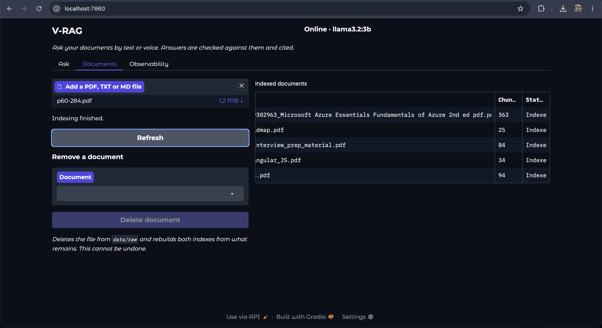
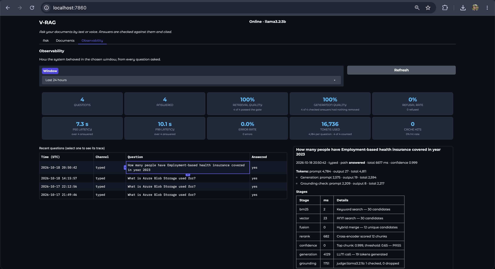
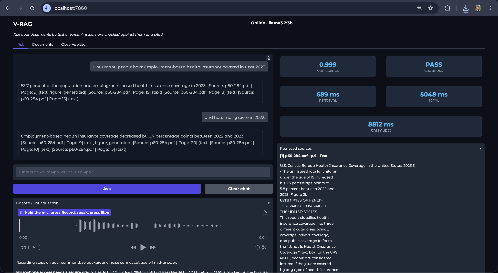

# V-RAG: Voice Enabled RAG Pipeline

Ask questions about your own documents, by typing or by speaking, and get answers taken only from those
documents, with the file and page each answer came from. When the documents don't contain the answer, V-RAG
says so instead of guessing.

It reads plain text, tables and charts inside PDFs, answers out loud, and runs entirely on your own
computer: no cloud services, no API keys, and nothing you ask leaves your machine.

## Live demo

**[Try it in your browser](https://prashantmaht0.github.io/Voice_Enabled_RAG_Pipeline/)**

<!-- Demo video: drag the recorded video file onto this spot while editing the README on GitHub. -->

The demo runs the same pipeline inside your browser, using your computer's graphics card. Four public sample
documents are ready to ask about, and you can add a short document of your own.

- It needs a browser with WebGPU: a current Chrome or Edge, Safari 26, or a recent Firefox.
- The first visit downloads the AI models (about 1 GB with the small model, 2.8 GB with the larger one). Later
  visits load from your browser's cache.
- Your questions, answers and voice stay in the browser. Only a document you upload is sent, to a free
  [Hugging Face Space](https://huggingface.co/spaces/Prashant-Mahto/vrag-pdf-reader) that reads it and deletes it.
  Uploads are limited to 3 a day, 5 pages and 10 MB each.

How it works: the rules that decide an answer are the same Python code the local version uses, run in the
browser by Pyodide. The browser supplies the models (WebLLM for Llama 3.2, transformers.js for search and
speech recognition, Kokoro for the voice), so answers can differ slightly from the local version.

## The S-Y-N-C-H-R-O-N-I-C Framework

V-RAG is built around ten principles for answers you can trust:

| Step | Principle | Idea |
| :--- | :--- | :--- |
| **S** | Standardize Ingestion | Clean every document the same way and give it a fingerprint. |
| **Y** | Yield Hybrid Results | Search by exact words and by meaning, then combine the results. |
| **N** | Narrow with ANN | Quickly shortlist the most promising passages, even among millions. |
| **C** | Cross-Encode (Rerank) | Re-read the shortlist carefully and put the best passages first. |
| **H** | Halt on Low Confidence | Refuse to answer when the passages aren't good enough. |
| **R** | Restrict the LLM | Tell the model to use only the passages, with creativity switched off. |
| **O** | Origin Citations | Point every claim back to its document and page. |
| **N** | NER & Assertion Checking | Check the answer's claims against the source text. |
| **I** | Inspect Continuously | Keep measuring quality to catch problems early. |
| **C** | Cache & Invalidate | Remember answers to repeated questions, and forget them when a document changes. |

## Credits

This project is built on the S-Y-N-C-H-R-O-N-I-C framework by **Vishal Mysore**, described in his article
[How to Design a RAG Pipeline for 10 Million Documents with Zero Hallucination](https://medium.com/@visrow/how-to-design-a-rag-pipeline-for-10-million-documents-with-zero-hallucination-live-demo-057e37bcdbf6)
and his [advancedRagDemo](https://github.com/vishalmysore/advancedRagDemo) repository. This repository is an
independent implementation of those ideas on a fully local stack.

## Project Screenshots

**Ask tab**


**Corpus tab**



**Corpus tab**



**A spoken question and its answer**



[Listen to a spoken answer](assets/audio_outputs/Voice_query_res.wav)

## Repository Layout

```
Voice_Enabled_RAG_Pipeline/
├── app.py              # The dashboard (Ask, Corpus and Observability tabs)
├── main.py             # The engine that answers questions (an API the dashboard talks to)
├── config/config.yaml  # Every setting in one place
├── src/                # The pipeline: reading documents, search, answering, checking, voice
├── demo/               # The live demo website
├── space/              # The document reader the live demo uses
├── tests/              # Automated tests, grouped by feature
├── data/eval/          # The question sets used to measure quality
├── assets/             # Diagram, screenshots and an audio sample
└── docker-compose.yml  # Runs everything with one command
```

## Architecture


The system has two parts.

**Reading your documents** (when it starts, and whenever you add or remove a document)

1. Each document is read page by page.
2. Tables are found and turned into proper rows and columns, and charts are described in words by a vision
   model, so their numbers can be searched too.
3. The text is cut into small passages, each labelled with its file and page.
4. The passages are stored in two search indexes: one for exact words, one for meaning. A new index is built
   next to the old one and swapped in only when it is complete.

**Answering a question**

1. A spoken question is turned into text. Silence or filler words are ignored.
2. A follow up question such as "how do I scale it?" is rewritten so it makes sense on its own.
3. If the same or a very similar question was answered before, that answer is returned at once.
4. Otherwise both indexes are searched, the results are combined, and a careful second model picks the five
   best passages.
5. If even the best passage is a poor match, V-RAG answers "Insufficient context" and stops.
6. Otherwise the answer model writes an answer using only those passages.
7. A small checking model reads each sentence of the answer and removes any sentence the passages don't
   support. If nothing is left, V-RAG gives the "Insufficient context" answer instead.
8. The answer is shown with its sources and spoken aloud, one sentence at a time, as soon as each sentence
   passes the check.

## How well does it work?

**Overall quality.** 67 questions about the *Microsoft Azure Essentials* book
([`data/eval/golden_dataset.json`](data/eval/golden_dataset.json)): 47 that the book answers, and 20 trick
questions it doesn't. Answer quality was scored by a separate local AI judge (Ragas with `llama3.1:8b`).

| What was measured | Goal | Result |
| --- | --- | --- |
| Answers backed by the documents | 0.85 or more | **0.868** |
| Answers that address the question | 0.85 or more | **0.953** |
| Trick questions refused | all 20 | **20 of 20** |
| Answerable questions answered | 90% or more | **44 of 47 (94%)** |

**Tables.** 29 questions whose answers sit only inside a table, from the Azure book and the
[Raspberry Pi 4 datasheet](https://datasheets.raspberrypi.com/rpi4/raspberry-pi-4-datasheet.pdf)
([`data/eval/table_questions.json`](data/eval/table_questions.json)).

| Setup | Right answer and page |
| --- | --- |
| Without table reading | 9 of 29 |
| With table reading (fine tuned LayoutLMv3) | **22 of 29** |

**Charts.** 31 questions whose answers appear only in a chart, from the US Census report
[Income and Poverty in the United States: 2020](https://www.census.gov/content/dam/Census/library/publications/2021/demo/p60-273.pdf)
and the [UN Sustainable Development Goals Report 2024](https://unstats.un.org/sdgs/report/2024/The-Sustainable-Development-Goals-Report-2024.pdf)
([`data/eval/figure_questions.json`](data/eval/figure_questions.json)).

| Setup | Right answers |
| --- | --- |
| Without chart reading | 4 of 31 |
| With chart reading (Qwen2.5 VL 7B) | **11 of 31** |

**Speed**, on an Apple M5 laptop with 16 GB of memory (typical times):

| Question | Time |
| --- | --- |
| Typed question | 6.7 s |
| The same question asked again | instant |
| A question it refuses | 1.2 s |
| Spoken question, until the full spoken answer is ready | 10.6 s |

The full Ragas output is in [`assets/ragas_gate_run.txt`](assets/ragas_gate_run.txt).

## Observability Tab

The Observability tab shows how the system has been doing, for the last hour, day, week, or all time:

- **How many questions** were asked, answered and refused.
- **Search quality:** how often the passages found were good enough to answer.
- **Answer quality:** how often the checking model kept the whole answer.
- **Speed:** how long each step takes, including how long until a spoken answer starts.
- **Tokens used** by the AI models, and how often a stored answer was reused.
- **Recent questions:** the last 50; select one to see every step it went through, the passages it used and
  any sentences that were removed.

Everything stays on your computer, in a small database next to the search index.

## Run the pipeline locally

You need [Docker](https://www.docker.com/products/docker-desktop/) (give it at least 8 GB of memory).

**1. Download the voice files**

```bash
mkdir -p models
curl -L -o models/kokoro-v1.0.onnx https://github.com/thewh1teagle/kokoro-onnx/releases/download/model-files-v1.0/kokoro-v1.0.onnx
curl -L -o models/voices-v1.0.bin https://github.com/thewh1teagle/kokoro-onnx/releases/download/model-files-v1.0/voices-v1.0.bin
```

**2. Start everything**

```bash
docker compose up
```

**3. Download the AI models** (first time only, in a second terminal, about 9 GB)

```bash
docker compose exec ollama ollama pull llama3.2:3b     # writes the answers
docker compose exec ollama ollama pull llama3.2:1b     # rewrites follow ups and checks answers
docker compose exec ollama ollama pull qwen2.5vl:7b    # describes charts while reading documents
```

Speech recognition, search and table models download by themselves the first time they are needed.

**4. Open the dashboard** at **http://localhost:7860** and upload your documents in the Corpus tab.

On a Mac, Docker can't use the graphics card, so answers are slow. If you have [Ollama](https://ollama.com)
installed on the Mac itself with the models above, start with
`VRAG_OLLAMA_HOST=http://host.docker.internal:11434 docker compose up` and skip step 3.

**Settings.** Everything you can change lives in [`config/config.yaml`](config/config.yaml). The most useful:

| Setting | What it changes |
| --- | --- |
| `retrieval.confidence_threshold` | How sure V-RAG must be before it answers (higher means more refusals). |
| `llm.generation_model` | Which model writes the answers. |
| `ingestion.table_parser`, `ingestion.figure_parser` | How tables and charts are read, or `none` to skip them. |
| `grounding.checker` | How answers are checked: `judge` (default) or `none`. |
| `voice.tts.voice` | Which voice reads the answers. |

Restart with `docker compose up` after changing a setting.

## License

V-RAG is released under the [MIT License](LICENSE).

The fine tuned table model it downloads,
[Prashant-Mahto/layoutlmv3-pubtables-table-words](https://huggingface.co/Prashant-Mahto/layoutlmv3-pubtables-table-words),
keeps LayoutLMv3's CC BY-NC-SA 4.0 license, which allows non commercial use only.

## Future Work

- **Hinglish:** questions spoken in a mix of Hindi and English.
- **More languages** for spoken questions and answers.
- **Documents in other languages**, answered in the language you ask in.
- **Faster spoken answers**, so the voice starts sooner after you finish speaking.
